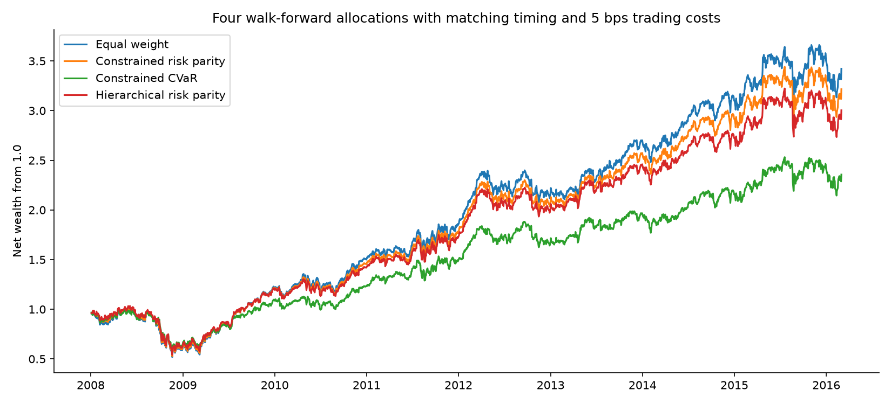
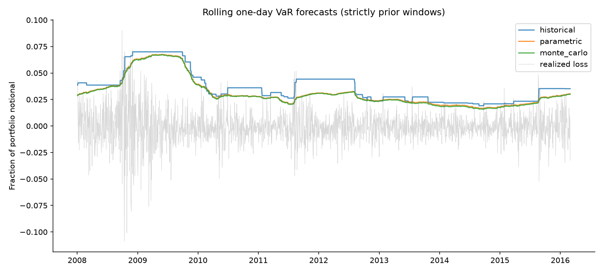
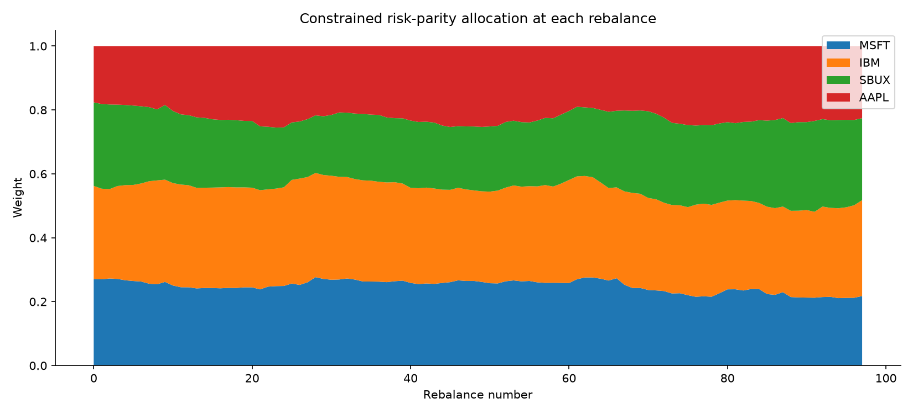
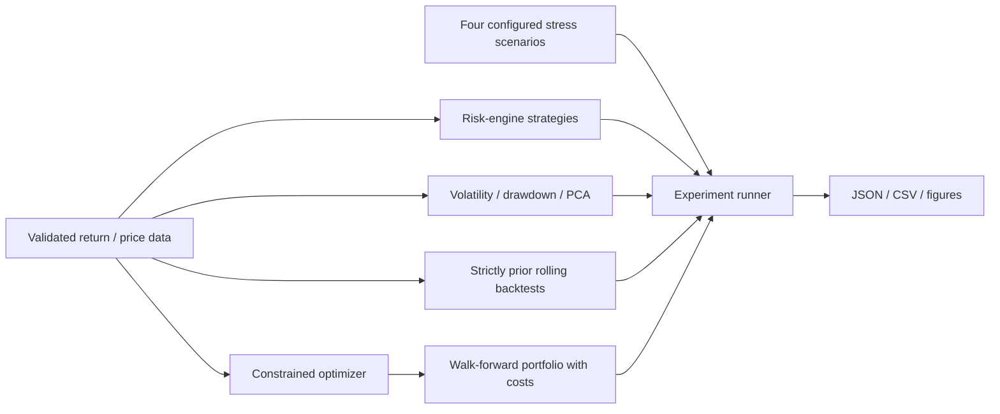

# RiskLab 2 — Enhanced Portfolio Risk Analytics & Stress Testing

An enhanced successor to [RiskLab](https://github.com/jituslpl-dev/risklab). Every original feature below remains available, including the original CLI. The enhanced workflow adds conditional tail models, sampling uncertainty, direct ES attribution, alternative allocations and inspectable reports. This is a research engine with reproducible engineering practices; no live trading or production regulatory service is claimed.

## Enhancements over version 1

| Addition | Concrete implementation |
|---|---|
| Filtered historical VaR/ES | Prior EWMA variance standardizes past portfolio shocks and rescales them to current volatility |
| Joint circular block bootstrap | Whole asset rows preserve contemporaneous dependence; blocks preserve local serial dependence for multi-day linear-return scenarios |
| Rolling Student-t comparison | Heavy-tailed Monte Carlo joins all original methods on the same forecast dates |
| Expected Shortfall asset attribution | Fractional empirical tail contributions reconcile to portfolio ES |
| Sampling uncertainty | Seeded block-bootstrap percentile intervals for historical VaR and ES |
| Forecast diagnostics | Quantile pinball loss and exploratory ES calibration residual with bootstrap intervals |
| Minimum-CVaR allocator | Sparse Rockafellar–Uryasev linear program; position bounds and exact L1 turnover constraints; HiGHS solver |
| Hierarchical risk parity | Shrinkage correlation, single linkage and recursive cluster allocation |
| Reverse stress testing | Minimum covariance-distance asset shock reaching a target portfolio loss |
| Four allocation comparison | Equal weight, constrained risk parity, constrained CVaR and HRP with matching timing, drifting holdings and costs |
| Reviewable reports | Offline HTML dashboard, six forecast CSVs, charts, allocation records and SHA-256 manifest |

### Run the enhanced project

Follow the environment installation below, then run:

```bash
python -m risklab.enhanced_cli --rows 756 --window 252 --draws 2000 --output reports/synthetic
# Installed command: risklab2
python scripts/fetch_sample.py
python -m risklab.enhanced_cli --input data/equity_prices.csv --prices --asset-classes data/equity_classes.json --draws 6000 --output reports/public_equities
```

Open `reports/public_equities/dashboard.html` in a browser. The enhanced CLI needs a window of at least 40 observations. The package distribution is `risklab-2`, while the `risklab` import namespace and original command stay compatible; use a separate virtual environment from version 1.

Read [measured benchmark results](docs/benchmark-results.md), [enhanced methodology and design decisions](docs/enhanced-methodology.md) and [enhanced report](reports/public_equities/enhancements.json). No algorithm is selected or tuned using these final benchmark results. Real validation remains equity-only; cross-asset validation is synthetic.



### Additional OOP and design patterns

`FilteredHistoricalEngine` and `BlockBootstrapEngine` implement the existing risk strategy contract. `CVaROptimizer` and `HierarchicalRiskParity` implement the allocator `solve` contract, so one simulator can compare allocations without hard-coding the algorithms. Frozen dataclasses hold estimator/optimizer configuration. The enhanced runner composes existing components and adds reporting; the CSV adapter and validation contracts remain shared. This uses Strategy, Adapter, immutable value objects, composition and dependency inversion without decorative inheritance.

New focused modules are `advanced.py`, `tail_optimization.py`, `hierarchical.py`, `diagnostics.py` and `enhanced_cli.py`. Windows/Linux CI runs both original and enhanced workflows and uploads their artifacts.

Local validation: **22 passing tests and 88.2% statement coverage** across the package, including a full enhanced-workflow artifact integration test. Coverage is saved in `reports/test_coverage.json`. Numerical tests verify exact LP/empirical CVaR agreement, fractional ES reconciliation, future-perturbation invariance, joint hedge preservation and shared strategy dates. CLI branches are also exercised by fresh CI experiments; coverage does not establish financial model correctness.

### Enhanced model boundaries

- Filtered historical simulation assumes zero-mean EWMA portfolio residuals; it is not a fitted GARCH model.
- Bootstrap horizons sum linear returns, not compounded dynamic trading; circular wrapping introduces a history-boundary assumption. One-day bootstrap resamples the empirical distribution.
- ES contribution allocation within tied portfolio losses can depend on stable observation order; the total always reconciles.
- Bootstrap intervals describe sampling sensitivity, not correctness. ES residual intervals are exploratory calibration diagnostics, not formal regulatory ES tests.
- CVaR allocation minimizes training-window 95% ES; risk forecasts use 99%. Out-of-sample tail reduction is not guaranteed.
- HRP is long-only and fully invested but does not enforce the constrained optimizers' bounds or turnover caps. Its clustering can be sensitive to near ties.
- Reverse stress distance is a covariance geometry measure, not a calibrated event probability; shocks implying asset returns at or below −100% are rejected.
- Research settings and honest unfavorable results are retained. No derivatives valuation, live execution, leverage, regulatory approval or production deployment is claimed.

### Enhanced Python examples

```python
from risklab.data import synthetic_market
from risklab.advanced import FilteredHistoricalEngine, BlockBootstrapEngine
from risklab.tail_optimization import CVaROptimizer, reverse_stress
from risklab.hierarchical import HierarchicalRiskParity
returns, _ = synthetic_market()
history = returns.iloc[-252:]
weights = [0.25] * 4
print(FilteredHistoricalEngine().estimate(history, weights))
print(BlockBootstrapEngine().estimate(history, weights, horizon=10))
print(CVaROptimizer(turnover_cap=0.1).solve(history, previous=weights))
print(HierarchicalRiskParity().solve(history))
print(reverse_stress(history, weights, loss_target=0.10))
```

The original résumé bullets remain valid. An expanded version is:

> Developed historical, parametric, Monte Carlo and volatility-filtered VaR/ES engines with block-bootstrap uncertainty and PCA/Euler/ES attribution. Built four configurable stresses, reverse stress testing and causal rolling validation; compared constrained risk parity, minimum-CVaR and HRP portfolios with transaction costs on synthetic cross-asset and public historical equity data.

## Preserved RiskLab capabilities and reference workflow

A reproducible quantitative-risk project using **NumPy, Pandas, SciPy and scikit-learn**. It implements historical, Gaussian parametric and Monte Carlo VaR/Expected Shortfall; asset and PCA risk attribution; four configurable stress scenarios; rolling statistical backtests; and constrained walk-forward risk parity.

The repository contains executable numerical tests, report CSV/JSON files and generated figures. It includes a synthetic four-asset-class experiment and an old public equity-price sample. Results are research demonstrations, not production capital calculations or investment recommendations.

## Features

| Area | Implemented capability |
|---|---|
| Tail-risk engines | Historical empirical VaR/ES, Gaussian parametric VaR/ES, Gaussian and Student-t Monte Carlo |
| Correct tail handling | Fractional empirical tail mass and quantile ties; CVaR/ES terminology documented |
| Volatility and wealth | Sample annualized volatility, EWMA volatility, compounded wealth and peak-to-trough drawdown |
| Risk attribution | Covariance PCA component variance, asset variance contributions, Euler volatility contributions |
| Stress testing | Equity crash, rates/inflation, liquidity freeze and stagflation; JSON-configurable class shocks |
| Backtesting | Strictly prior rolling VaR forecasts; Kupiec, exact binomial, Christoffersen independence and conditional coverage |
| Optimization | Constrained equal-risk-budget approximation with long-only bounds, optional volatility cap and turnover cap |
| Regimes and trading | Causal volatility regimes, monthly rebalancing, drifting holdings and transaction costs |
| Reproducibility | Fixed seeds, input hashes, public sample provenance, matched equal-weight baseline, report artifacts |
| Engineering | Installable `src/` package, strategy Protocol, immutable configuration, tests, formatting and Windows/Linux CI |

## Quick start

Python 3.12 is the tested runtime. Run from the repository root.

```bash
python -m venv .venv
# Windows PowerShell:
.venv\Scripts\Activate.ps1
# macOS/Linux instead: source .venv/bin/activate
python -m pip install -r requirements-lock.txt -r requirements-dev.txt
python -m pip install --no-deps -e .
python -m pytest -q
python -m risklab.cli
```

The default experiment generates 1,512 synthetic business-day observations for Equity, Bond, Gold and FX, uses equal starting weights, confidence 99%, a 252-observation forecast window, and 6,000 Monte Carlo draws per estimate. It writes `reports/synthetic/summary.json`, method-level forecast CSVs, walk-forward return CSVs, rebalance diagnostics and four figures. No external service or account is required.

The command is also installed as `risklab`. For a faster reproducibility smoke run:

```bash
risklab --rows 420 --window 126 --draws 2000 --output reports/smoke
```

## Public historical sample

```bash
python scripts/fetch_sample.py
python -m risklab.cli --input data/equity_prices.csv --prices --asset-classes data/equity_classes.json --output reports/public_equities
```

The downloader uses [Plotly's public stockdata sample](https://github.com/plotly/datasets/blob/master/stockdata.csv), selecting MSFT, IBM, SBUX and AAPL. Raw data stays in the Git-ignored `data/` directory. The sample has 2,306 price dates and 2,305 return observations, spanning 2007–2016. It is **equity-only**; cross-asset scenarios are demonstrated on synthetic data. Price adjustment/dividend provenance is not independently verified. The chosen surviving companies introduce selection/survivorship limitations; this is not an investable total-return benchmark.

The downloader records the upstream URL and raw SHA-256. The report records the normalized input SHA-256. Results depend on the fetched snapshot; use the hashes to identify the evaluated files.

### Measured 99% rolling VaR results

The public equity experiment uses 2,053 out-of-sample one-day forecasts, a 252-observation rolling window, fixed equal weights and strictly earlier observations. An expected exception rate of 1% implies approximately 20.53 exceptions.

| Engine | Exceptions | Exception rate | Kupiec coverage p-value |
|---|---:|---:|---:|
| Historical | 25 | 1.22% | 0.338 |
| Gaussian parametric | 45 | 2.19% | 0.00000275 |
| Gaussian Monte Carlo, shrinkage covariance | 48 | 2.34% | 0.000000207 |

The Gaussian engines understate tail risk in this sample; their coverage tests reject at conventional significance levels. Historical coverage is not rejected by this test, which is **not proof that the model is correct**. Monte Carlo changes numerical estimation, not the underlying Gaussian model assumptions. The Student-t engine is implemented and evaluated for the latest window; the default rolling comparison contains the three requested engines.

### Walk-forward risk parity versus equal weight

Both strategies use the same 252-observation history, 21-observation rebalance schedule, holdings drift and 5 bps cost per dollar of traded notional. Risk parity enforces 2%–60% asset bounds and an L1 turnover cap of 0.8 at rebalances after inception. The final public-sample run has 98 rebalances across 9 calm, 54 high-volatility and 35 crisis classifications.

| Public equity experiment | Risk parity | Equal weight |
|---|---:|---:|
| Annualized net volatility | 23.14% | 23.67% |
| Maximum drawdown | −48.33% | −49.08% |
| Annualized geometric net return | 15.42% | 16.30% |

Risk parity did not outperform equal weight on geometric return in this experiment. Its purpose is allocating risk, not guaranteeing higher returns or lower losses. The 2007–2016 period and equity-only sample do not establish current cross-asset performance.




## Architecture



```text
src/risklab/
  engines.py          RiskEngine Protocol and estimator strategies
  analytics.py        volatility, drawdown and PCA/Euler attribution
  backtesting.py      rolling forecasts and statistical coverage tests
  optimization.py     constrained risk parity and equal-weight baseline
  regimes.py          causal regimes and walk-forward trading
  stress.py           immutable stress scenario and JSON loader
  validation.py       numerical, allocation and date contracts
  data.py             synthetic market and CSV adapters
  plotting.py         reproducible headless figures
  cli.py              composed experiment workflow
config/scenarios.json four hypothetical asset-class shocks
scripts/fetch_sample.py public sample downloader and provenance
tests/                finance identities, leakage and constraint tests
docs/                 detailed methodology and interview walkthrough
reports/              committed measured results and figures
```

Design patterns are concrete: `RiskEngine` is a structural Protocol; historical/parametric/Monte Carlo estimators are interchangeable strategies. Frozen dataclasses hold risk estimates, Monte Carlo settings, optimizer settings and stress configuration. `EqualWeightAllocator` shares the optimizer's `solve` contract so the same trading simulator can compare strategies. The runner composes components; it does not mix file parsing into finance formulas. No inheritance hierarchy is added solely for presentation.

## API examples

```python
from risklab.data import synthetic_market
from risklab.engines import HistoricalEngine, ParametricEngine, MonteCarloEngine
from risklab.optimization import RiskParityOptimizer
from risklab.analytics import pca_attribution

returns, generator_labels = synthetic_market()
weights = [0.25] * 4
history = returns.iloc[-252:]
print(HistoricalEngine().estimate(history, weights, confidence=0.99))
print(ParametricEngine().estimate(history, weights, confidence=0.99, horizon=10))
print(MonteCarloEngine(distribution="student_t").estimate(history, weights))
solution = RiskParityOptimizer(upper_bound=0.6, annual_volatility_cap=0.15).solve(history)
attribution = pca_attribution(history, solution["weights"], list(history.columns))
```

An overly restrictive volatility/turnover cap raises `OptimizationError`; it is not silently relaxed. The default CLI uses no volatility cap because feasibility depends on the data. The Python optimizer supports a configurable positive cap.

External CSVs must have an increasing unique Date index and complete finite columns. With `--prices`, levels must be positive; simple returns are calculated without forward-filling. An asset-class JSON must map columns in the same order to their stress classes. Missing observations, duplicate dates, negative weights and weights that do not sum to one are rejected.

## Configuring stresses

Edit `config/scenarios.json` or pass `--scenarios PATH`. Each of the four scenario names maps `equity`, `bond`, `commodity` and `fx` to fractional simple-return shocks. For example, −0.25 means a 25% decline. `StressScenario.evaluate(..., notional=...)` reports asset contributions and portfolio P&L.

The rates/inflation scenario specifies a direct bond price-return shock, not a yield shock converted using duration/convexity. The four cases are hypothetical narratives, not calibrated reproductions of past crises.

## Numerical conventions and limitations

- Loss is negative portfolio return. VaR and ES are reported as fractions of notional; positive values mean losses.
- Historical VaR uses an empirical generalized inverse. ES uses the exact upper-tail probability mass, including fractional boundary weight. CVaR/Expected Shortfall refer to the same implemented measure.
- Parametric multi-day scaling assumes IID Gaussian returns. Historical horizons use overlapping linear-return sums; Monte Carlo sums independent simulated daily marginal returns. Horizons 1–21 are supported, but statistical rolling tests use one day.
- PCA decomposes raw return covariance. It attributes variance and volatility, not arbitrary non-Gaussian CVaR. Hedge contributions can be negative.
- Optimization approximates equal risk budgets under constraints and reports deviations, solver status, volatility and turnover. Exact parity is not guaranteed when bounds bind.
- Regime labels use trailing 20-observation equal-weight volatility and fixed 10%/20% annualized thresholds. They are observable labels, not future regime forecasts.
- Formal ES backtesting, derivatives repricing, leveraged/short portfolios, funding/margin and regulatory capital calculations are outside this implementation.

See [methodology](docs/methodology.md) for formulas, tail-boundary treatment, transition-test edge cases and trading conventions. Numerical optimization uses [SciPy SLSQP](https://docs.scipy.org/doc/scipy/reference/optimize.minimize-slsqp.html); covariance estimation uses scikit-learn Ledoit–Wolf.

## Testing and reproducibility

```bash
ruff check src tests scripts
ruff format --check src tests scripts
python -m pytest -q --cov=risklab --cov-report=term-missing
```

Tests verify empirical tail fractions/ties, Gaussian formulas, Monte Carlo agreement and reproducibility, tail ordering, initial-loss drawdown, PCA reconciliation, future-perturbation invariance, exception clustering, degenerate transition tests, transaction costs, feasible/infeasible optimization and stress P&L reconciliation. Windows/Linux CI runs the tests and a fresh synthetic experiment and uploads its reports. Public downloads are kept outside default CI to avoid dependence on a data host.

Reports contain unfavorable model coverage and strategy comparisons as well as successful numerical checks. Do not choose a model using final benchmark results and present the same data as untouched validation. For an actual deployment, use longer independently sourced total-return histories, explicit label/instrument conventions, repeated walk-forward validation and appropriate operational controls.

## Resume wording and interview walkthrough

> Developed historical, Gaussian parametric and Monte Carlo VaR/Expected Shortfall engines with volatility, drawdown and PCA/Euler risk attribution. Built four configurable cross-asset stress scenarios, rolling VaR coverage backtests and constrained walk-forward risk parity with transaction costs; evaluated on synthetic multi-asset and public historical equity samples.

The [interview guide](docs/interview-guide.md) explains modeling choices, failure cases, leakage controls and optimization tradeoffs. Mention that real-data validation is equity-only and that cross-asset validation uses synthetic data.
